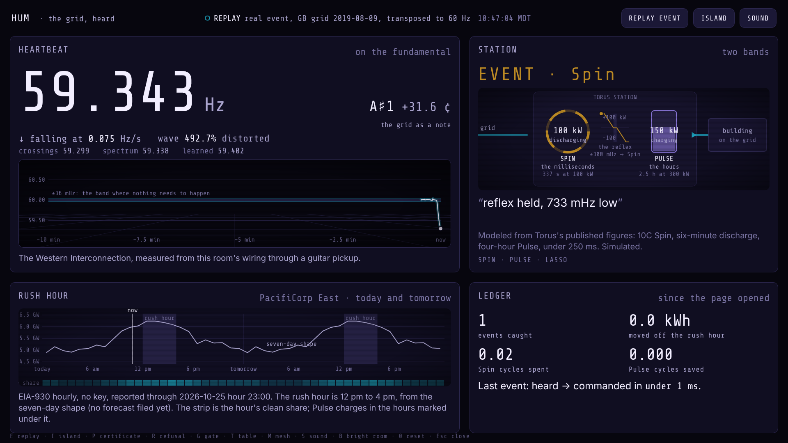

# HUM · the grid, heard

The power grid's frequency, heard live from a room's wiring through a guitar pickup, and a Torus Station answering in two bands, decided by a program whose compiler proves what it can never do.

Hard Tech Week 2026, Salt Lake City. Entered for the Torus bounty ("software that knows when the grid is jammed and stays out of traffic") and the Nucleus / Startup State open call. Every commit in this repository is from the hackathon week; what existed before is in [sonido](https://github.com/ampactor-labs/sonido) and [Mentl](https://github.com/ampactor-labs/mentl).



## In one breath

Every wire in a building hums at the grid's frequency, and that frequency is set by every generator on the Western Interconnection together: it sags when the whole grid is short, and the rate it falls says how fast a plant just dropped. A guitar pickup hears the hum. The ear in this repository reads it to the millihertz three independent ways. A Torus Station, modeled from Torus's published figures, answers in two bands: Spin takes the milliseconds, Pulse takes the hours, and when the hum dies the Station carries the building. The program that decides is written in Mentl, and its compiler proves it cannot reach the network, cannot touch the filesystem, cannot allocate mid-decision and cannot command either machine past its rating, through every call. Every decision says why, in words.

## What is real and what is simulated

- **Real:** the hum and its frequency (live, or from a recording made in the room), PacifiCorp East's hours from EIA-930, the 9 August 2019 disturbance on the GB grid from NESO's open one-second data (transposed to 60 Hz per unit and labeled so on every screen), the proofs.
- **Simulated, and labeled where it appears:** the Station's response (Spin 100 kW / 10 kWh, Pulse 300 kW / 1,200 kWh, from Torus's published 10C, six-minute and four-hour figures), the building's load, the mesh screen.

## Run it

```
(cd ear && cargo build --release)                 # the ear, against sonido by git
python3 -I build_data.py --out data               # PacifiCorp East's hours and the event (EIA_API_KEY optional)
./run.sh live                                     # the guitar on the interface, through PipeWire
./run.sh wav samples/hum_home.wav
./run.sh replay                                   # the real event, from eight seconds before its fall
STUB=1 ./run.sh sample samples/ear_event.ndjson   # no Mentl needed: the stand-in controller
```

The page is at http://127.0.0.1:8787/. Keys: `E` replay event · `I` island · `P` certificate · `A` the compiler's words · `R` refusal · `G` the gate · `T` table · `M` mesh · `S` sound · `B` bright room · `0` reset. The sixty-second venue drill is `setup.md`. A copy of this directory served statically, with no director, plays `sessions/default.ndjson`: four and a half minutes recorded with the real controller, the real event and the hum dying.

`samples/event_gb.wav` is the real event rendered as a hum (95 seconds from 25 s on its clock, 8 kHz, labeled): on a track in Bitwig under the sonido tuner, the note reads B, then A♯, and the room hears the pitch fall.

The Mentl programs live in the Mentl repository under `examples/grid/`: `station.mn` (the controller), `station-leak.mn` (the refusal twin), `listen.mn` (the learner). `mentl check examples/grid/station-leak.mn` is the refusal; `mentl audit examples/grid/station.mn` is the certificate; `mentl why examples/grid/station.mn decide Network` answers "the row of decide carries no Network". What they are and what was measured is `MENTL_BRIEF.md`; the captured text is under `pitch/`.

## The pieces

| Piece | Where | What it does |
| --- | --- | --- |
| The estimator | sonido, `crates/sonido-core/src/grid.rs` | `no_std`: three bandpasses on the hum's harmonics, the loudest tracked, periods between zero crossings read to a fraction of a sample; frequency over 100 ms and 1 s, rate of change over 300 ms, level, and "the hum is gone". Shared by the ear and the pedal. |
| The ear | `ear/` | A binary crate on sonido: live float stream, WAV, tone, replay or silence in; a spectral estimate and THD from a two-second window; one C1 line every 50 ms. |
| The pedal | sonido, `crates/sonido-daisy/examples/grid_pedal.rs` | The same estimator on a Daisy Seed in a Hothouse, lines over USB serial, the LEDs breathing with the grid. |
| The director | `director.py` | Spawns the ear and the controller, enriches the lines with the hour, the rush window and the clean share, keeps the traces and the ledger, serves the page, records the session. |
| The page | `index.html` | The five panels, the overlays, the sound, the playback mode. One file, no dependencies. |
| The data | `build_data.py`, `data/` | PacifiCorp East's demand, day-ahead forecast and clean share by hour; the event. |
| The pitch | `pitch/` | Both decks with appendices, the one-page plan, the scripts and the question bank, the PDF export. |
| The contracts | `CONTRACTS.md` | The line formats every process speaks. |

## Measured

On a synthesized hum with harmonics and noise at −30 dB: the one-second reading within 0.5 mHz, the spectral reading within 0.2 mHz, the rate of change under 0.023 Hz/s at rest. A replayed trip falling at 0.20 Hz/s crosses the 0.10 Hz/s trigger 250 ms after it starts. A hum cut to silence reads lost 350 ms later.

## Before kickoff and this week

`./ledger.sh ~/mentl` prints every commit in this repository, in sonido and in Mentl since Monday Oct 26 at 4:00 PM MDT, with timestamps, and the age of each repository.
